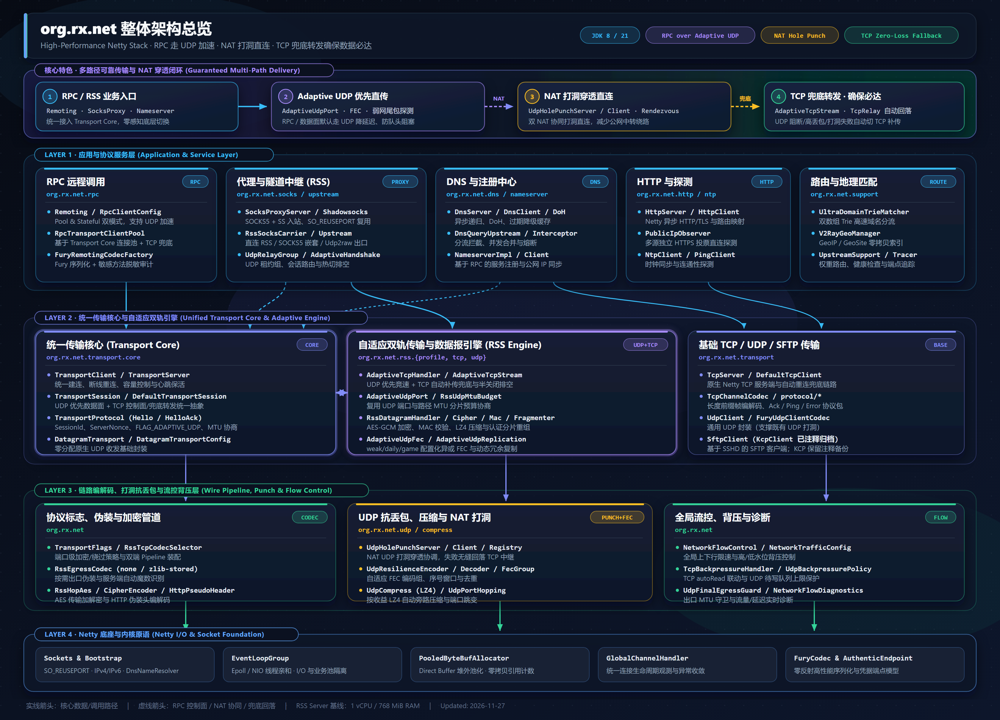

# `org.rx.net` 整体架构介绍

> 面向 **JDK 8 / JDK 21** 的高性能 Netty 底层网络与传输栈。严格遵循零分配热点、堆外 `PooledByteBufAllocator`、EventLoop 线程亲和与单核 / 768 MiB RSS Server 内存预算基线。

> 矢量高清原图：[org-rx-net-architecture.svg](org-rx-net-architecture.svg)

---

## 核心特色：多路径可靠传输与 NAT 穿透闭环

`org.rx.net` 的核心差异化能力在于将 **RPC、Nameserver 与 RSS 代理** 统一收敛到 `Transport Core` 之上，形成「**UDP 优先加速 → NAT 打洞直连 → TCP 自动兜底转发**」三级闭环，确保在任意网络条件下**数据 100% 必达**：

1. **RPC / RSS 统一接入**：`Remoting`、`SocksProxyServer`、`NameserverImpl` 通过 `TransportClient` / `TransportServer` 共享会话抽象，上层业务零感知底层传输切换。
2. **Adaptive UDP 优先直传**：默认通过 `AdaptiveUdpPort` + `RssDatagramHandler`（按收益 LZ4 + 认证分片 + 异或 FEC / 弱网尾包探测）走 UDP 快轨，降低高丢包网络下的队头阻塞与尾延迟。
3. **NAT 打洞穿透直连**：借助 `UdpHolePunchServer` / `UdpHolePunchClient` 协同打洞建立点对点直连，减少公网中转绕路与延迟（双 NAT 公网 Rendezvous 演进见 [roadmap-plan.md](roadmap-plan.md)）。
4. **TCP 兜底转发 · 确保必达**：当 UDP 被运营商限速/阻断、连续高丢包或 NAT 打洞失败时，`AdaptiveTcpStream` / `TcpServer` 无缝回落 TCP 补传与转发，保障连接不断、数据不丢。

---

## 分层设计总览

### Layer 1 · 应用与协议服务层（Application & Service Layer）

| 模块 | 包路径 | 核心组件 | 职责 | 详细文档 |
| --- | --- | --- | --- | --- |
| **RPC 远程调用** | `org.rx.net.rpc` | `Remoting`、`RpcClientConfig`、`RpcServerConfig`、`RpcTransportClientPool`、`FuryRemotingCodecFactory` | 基于 Transport Core 的双模式 RPC（Pool 连接池 / Stateful 有状态事件订阅），支持自动重连事件重订阅与敏感方法脱敏 | [rpc.md](reference/net/rpc.md) |
| **代理与隧道中继** | `org.rx.net.socks` | `SocksProxyServer`、`ShadowsocksServer`、`RssSocksCarrier`、`UdpRelayGroupManager`、`Udp2rawHandler`、`httptunnel` | SOCKS5 / Shadowsocks 入站（支持 `SO_REUSEPORT` 与优雅排空热切）、直连 RSS / 嵌套 SOCKS5 / `udp2raw` 出口与 UDP 租约组中继 | [socks.md](reference/net/socks.md) · [rss-transport.md](rss-transport.md) |
| **DNS 与注册中心** | `org.rx.net.dns` / `org.rx.net.nameserver` | `DnsServer`、`DnsClient`、`DoHClient`、`DnsQueryUpstream`、`NameserverImpl`、`NameserverClient` | 异步递归 DNS、DoH、过期降级缓存、分流拦截与熔断；基于 RPC 的服务注册与公网 IP 同步 | [dns.md](reference/net/dns.md) · [nameserver.md](reference/net/nameserver.md) |
| **HTTP 与探测** | `org.rx.net.http` / `org.rx.net.ntp` | `HttpServer`、`HttpClient`、`PublicIpObserver`、`NtpClient`、`PingClient` | Netty 异步 HTTP/TLS 服务端与客户端；多源独立 HTTPS 投票直连公网 IP 观测；时钟同步与连通性探测 | [http.md](reference/net/http.md) · [ntp.md](reference/net/ntp.md) |
| **路由与地理匹配** | `org.rx.net.support` | `UltraDomainTrieMatcher`、`V2RayGeoManager`、`UpstreamSupport`、`EndpointTracer` | 双数组 Trie 域名高速分流、GeoIP/GeoSite 索引、权重上游路由与健康检查 | [support.md](reference/net/support.md) |

---

### Layer 2 · 统一传输核心与自适应双轨引擎（Unified Transport Core & Adaptive Engine）

1. **统一传输核心（`org.rx.net.transport.core`）**
   - `TransportClient` / `TransportServer` / `TransportSession` / `DefaultTransportSession`：取代历史分散的 `Hybrid*` 实现，统一 RPC、Nameserver 与 RSS 控制面的建连、重连、容量控制、心跳保活与会话生命周期。
   - `TransportProtocol`：精简二进制 `Hello` / `HelloAck` 握手，协商 `sessionId`、`serverNonce`、`FLAG_ADAPTIVE_UDP` 与 `udpMtu`。
   - `DatagramTransport`：零分配原生 UDP 收发封装。
   - 详见 [transport.md](reference/net/transport.md)。

2. **自适应双轨传输与数据报引擎（`org.rx.net.rss.{profile, tcp, udp}`）**
   - `AdaptiveTcpHandler` / `AdaptiveTcpStream`：TCP 主通道 + 可选 Adaptive UDP 加速轨，支持乱序重组、弱网尾包探测、高 BDP 回落保护与优雅半关闭排空（`shutdownOutput()`）。
   - `AdaptiveUdpPort` / `RssUdpMtuBudget`：服务端/客户端复用 UDP 端口与路径 MTU 预算协商。
   - `RssDatagramHandler` / `RssDatagramCipher` / `RssDatagramMac` / `RssDatagramCompression` / `RssDatagramFragmenter`：统一负责普通增强 UDP 的按收益 LZ4 压缩、认证分片重组、异或 FEC（`AdaptiveUdpFec`）/ 动态冗余复制（`AdaptiveUdpReplication`）及外层 AES-128-GCM / MAC 封装。
   - Profile 体系：`plain`（纯直通/仅可选加密）、`daily`（日常均衡双轨+低开销 FEC）、`weak`（高丢包尾包优先与 SACK 探测）、`game`（低延迟动态 1x~3x 冗余复制）。详见 [rss-transport.md](rss-transport.md)。

3. **基础 TCP / UDP / SFTP 传输（`org.rx.net.transport`）**
   - `TcpServer`、`DefaultTcpClient`、`AbstractTcpReconnectClient`、`TcpChannelCodec`：原生 Netty TCP 服务端与自动重连客户端。
   - `UdpClient`：独立保留用于旧版 UDP 打洞（待迁移或退役后移除）；`KcpClient` / `KcpClientConfig` 已全量注释归档备查；`SftpClient` 提供 SSHD SFTP 支持。

---

### Layer 3 · 链路编解码、抗丢包与流控背压层（Wire Pipeline, Resilience & Flow Control）

- **协议标志与加密/伪装管道（`org.rx.net`）**：
  - `TransportFlags` 与 `RssTcpCodecSelector` 控制端口级加密/绕过与 Pipeline 装配。
  - `RssEgressCodec` 支持 `none` 与 `zlib-stored` 按需出口包装，服务端按首字节魔数自动识别。
  - `RssHopAes` 提供基于 32B PSK 派生每连接/每方向独立密钥的 AES-128-GCM 流加密。
- **UDP 抗丢包、压缩与打洞（`org.rx.net.udp`）**：
  - `UdpResilience*` / `FecEncodeGroup` / `FecDecodeGroup`、`UdpCompress*`（LZ4 自适应旁路）、`UdpPortHoppingConfig`、`UdpHolePunchServer` / `Client`。详见 [udp.md](reference/net/udp.md) · [punch.md](reference/net/punch.md)。
- **全局流控、背压与诊断（`org.rx.net`）**：
  - `NetworkFlowControl`、`TcpBackpressureHandler`、`UdpBackpressurePolicy`、`UdpFinalEgressGuardHandler`、`NetworkFlowDiagnostics`。详见 [flow-control.md](reference/net/flow-control.md)。

---

### Layer 4 · Netty 底座与内核原语（Netty I/O & Socket Foundation）

- **`Sockets`**：统一 Bootstrap 构建、`SO_REUSEPORT` 多核绑定、IPv4/IPv6 双栈、非阻塞 `DnsNameResolver` 与全局公网 IP 解析。
- **`EventLoopGroup`**：Linux 优先 Epoll，I/O 线程与业务线程池严格隔离。
- **`PooledByteBufAllocator`**：全链路 Direct Buffer 池化与零拷贝引用计数管理（回归测试强制开启 `PARANOID` 泄漏检测）。
- **`GlobalChannelHandler` / `FuryCodecSupport` / `AuthenticEndpoint`**：统一连接观测、零反射高性能序列化与凭据端点抽象。详见 [core.md](reference/net/core.md)。
