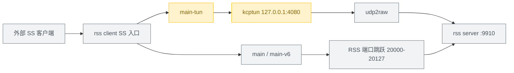
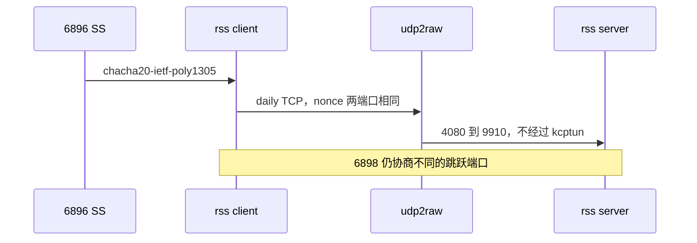

# 技术方案 - RSS: 6896 加密可配与单用户关闭端口跳跃

- 日期: 2026-11-25
- 状态: 草稿，待确认后才改代码和现网
- 关联配置: rss client `/home/rss/conf.yml`
- 范围: 只动 6896（`rGrey`）和它使用的 `main-tun`。6899、6898、6897 的 SS 加密、profile、上游保持现状。服务端全局 `udpHopPorts=20000-20127` 不关。

本方案没有 HTTP API，不单列接口清单和原型文档。

## 1. 要做成什么样

6896 增加可配置的 SS 加密算法，设为 `chacha20-ietf-poly1305`。上游仍是 `main-tun`，传输 profile 用 `daily`，但这一条用户不协商 RSS 端口跳跃，因为流量已经走 udp2raw。其他用户继续按各自配置，6898 的 daily 仍使用端口跳跃。

kcptun 不是这次的 Java 改动。它是 `main-tun` 的 TCP 外层：客户端 `127.0.0.1:4080` 现在是 kcptun，后面才接到 udp2raw。只停进程会把 6896 的 TCP 打断。确认本方案后，运维上先把 udp2raw 直接接到 4080 / 9910，再停两端 kcptun，并删掉只负责拉起 kcptun 的 cron。udp2raw 进程和它自己的保活保留。

## 2. 现状



图例：🟡 本方案要改的路径 / ⚪ 现有且保持

- 运行中的 client jar 在 `RssRuntime.createShadowServer` 写死 `CipherKind.AES_256_GCM`。`ShadowUser` 只有 `ssPort`、`ssPwd`、`socksUser`、`transport`、`socksServers`，没有加密字段。只改 YAML 会被忽略，6896 仍是 `aes-256-gcm`。
- `transport.profile: daily` 的默认 `fec` 是 3。代码里 TCP 自适应是否开启看 `fec & 2`。开启后，握手 nonce 写入一对跳跃端口，客户端 `AdaptiveUdpPort` 在两个端口不同时做跳跃。现有 `fec: 0` 会连 daily 的自适应 XOR 和 TCP 修复一起关掉，不能表达「daily，但这一条不跳跃」。
- 6898 已是 `profile: daily` 且走 `main-v6`，要继续跳跃。
- `main-tun` 已是 `udp2raw: true`，TCP `127.0.0.1:4080`，UDP `127.0.0.1:4090`。4080 当前是 kcptun 监听口。

## 3. 代码改动

只改 rss client 的用户配置和出站策略。热点路径仍在建连时取一次算法名和跳跃开关，不在每包上解析 YAML 或分配策略对象。

### 3.1 SS 加密算法

`ShadowUser` 增加 `ssCipher`。空值或未写等于 `aes-256-gcm`。合法值只接受 `CipherKind` 已有名称：`aes-128-gcm`、`aes-256-gcm`、`chacha20-ietf-poly1305`。

配置校验失败时，沿用现在的热加载规则：拒绝本次文件，进程继续用上一份配置。`ShadowServerRef.matches` 把算法算进去。只有算法或口令变化的那个 SS 端口重绑，其他端口的监听不动。

`createShadowServer` 用该用户的算法创建 `ShadowsocksConfig`，不再写死 AES-256-GCM。

### 3.2 仅该用户关闭端口跳跃

`RssTransport` 增加 `Boolean udpHop`。不写时保持今天的行为：daily / game / weak 该跳跃的仍然跳跃。

6896 写成 `udpHop: false`，同时 `profile: daily`。效果：

- TCP 仍走 daily：zlib 3、自适应 XOR、TCP 修复。协商 ID 仍是 daily 的 0。
- 这一条连接的 nonce 里两个端口写同一个值。客户端按现有 `primary != alias` 判断，不再开第二跳。
- 服务端按 nonce 里的端口回包。两个值相同就不会在 20000–20127 之间换端口。服务端全局监听和 6898 的跳跃不改。
- 该用户的普通 UDP 不申请跳跃会话，业务 UDP 走 `main-tun` 的 `udpClient`（udp2raw 4090）。不在 udp2raw 外面再套一层 RSS 端口跳跃。

6898 不写 `udpHop`，daily 跳跃保持。



图例：6896 这条是新行为；6898 仍走现有跳跃。

### 3.3 不改的代码

- 不改 `CipherKind` 的算法实现。
- 不改服务端启动参数 `-udpHopPorts`。
- 不改 6899、6898、6897 的配置解析默认值。
- 不把 `fec: 0` 当作本次开关。那会关掉 daily 的 TCP 自适应。

## 4. 确认后的配置

只改 6896 这一段，其他 `shadowUsers` 原样：

```yaml
- ssPort: 6896
  ssCipher: chacha20-ietf-poly1305
  ssPwd: <保持现口令>
  socksUser: rGrey
  ipLimit: -1
  transport:
    profile: daily
    udpHop: false
  socksServers:
    - main-tun
```

`main-tun` 继续 `udp2raw: true`。kcptun 去掉之后，客户端 udp2raw 直接监听 `127.0.0.1:4080`，对端仍是 `202.91.34.9:4080`；服务端 udp2raw 的 4080 直接转到 `127.0.0.1:9910`。UDP 4090 这条本来就没有 kcptun，保持不动。

## 5. 发布和回退

1. 备份 `/home/rss/conf.yml`、两端 `/home/udp2raw/start.json` 和 crontab。
2. 改 udp2raw 接线并确认 4080 已由 udp2raw 监听后，再停 kcptun，删除 kcptun 保活 cron。udp2raw 保活保留。
3. 发布带 `ssCipher` / `udpHop` 的 rss client jar。现网 jar 不认识新字段，不能只热加载配置。按现有 A/B 启动入口替换 client。rss server jar 不因加密算法变更而更换。
4. 写入第 4 节配置，等 `rssConf reload ok`。预期只有 6896 重绑。
5. 回退：恢复备份的 `conf.yml` 与 udp2raw/cron，停掉新接线前的 kcptun 由备份脚本拉起。client jar 用发布目录里的上一份。

## 6. 验证

- 6896 用 `chacha20-ietf-poly1305` 和原口令访问 `www.google.com/generate_204`，得到 HTTP 204。用 `aes-256-gcm` 连 6896 应失败。
- 6899、6898、6897 仍用 `aes-256-gcm` 得到 HTTP 204。
- 6898 的新连接仍出现跳跃端口。6896 的新连接不出现第二跳端口，TCP 仍能在 udp2raw 上完成。
- 两端进程列表里没有 `client_linux_amd64` / `server_linux_amd64`。crontab 不再拉起它们。udp2raw 仍在。
- 配置写成不认识的算法时，日志拒绝热加载，四个现有端口保持改前行为。

## 7. 待确认

1. `udpHop: false` 的口径是否就是上面第 3.2 节：daily 的 TCP 能力保留，只是这一条用户不跳端口，UDP 改走 udp2raw 单通道。
2. 字段名用 `ssCipher` 和 `transport.udpHop` 是否可以。
3. kcptun 是否按第 5 节的顺序拆掉。确认前不改代码，也不动现网进程。
