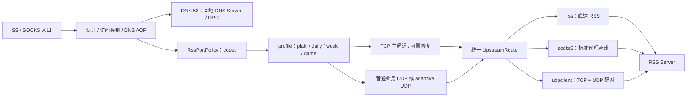
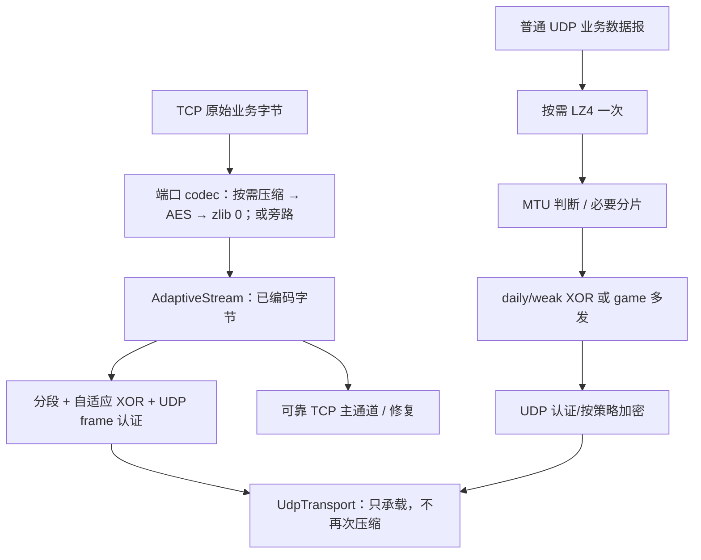
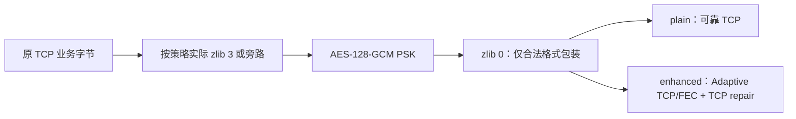

# RSS 上游与传输 Profile 收口方案

- 日期：2026-11-26（第三版：全模式端口安全策略、AES/zlib 顺序、DNS AOP 与命名收口）
- 审查基线：[14a05824](https://github.com/RockyLOMO/rxlib/commit/14a05824431f5b6118aec5a24330aca1d6f29c1e)
- 状态：待实施的独立计划；本文不是已完成的代码变更。
- 优先级：正确交付、认证安全和兼容性为硬约束；真实流量低、CPU 低、内存适当放宽且有界。game 在合理流量预算内优先低延迟。
- 本方案作为后续 RSS 上游/profile 设计的统一依据，覆盖旧方案中与本文冲突的上游分类、特殊路由及默认增强策略；历史 Review 和测试结果作为历史记录保留。

## 1. 收口结论

**增强层与上游承载层彻底解耦。**

RSS Client 只公开四种 profile 和三类上游。profile 决定是否及如何增强；上游负责建立 TCP 字节流、发送/接收 UDP 数据报，并明确可达的 RSS Server 及控制面。端口跳跃是 UDP 路径策略，不是 FEC 算法，也不是上游类型。

- 已剔除的 kcptun 不再作为运行依赖、上游类型、配置项、兼容分支、运维脚本、构建/测试依赖或后续验收目标；不保留专为单协议外层设置的例外。后续清理生产源码、活跃配置及部署文档中的残留，不恢复该依赖。旧历史评审仅作归档，不再用其指导新实现。
- RSS 上游必须作为一个逻辑对象同时具备 TCP 与 UDP 能力；可以由不同物理端点配对组成，但不得把仅支持单协议的进程或 endpoint 当作完整上游。
- 只有 daily / weak / game 可以配置额外 UDP 承载上游（包括固定 UDP client 及 adaptive UDP 映射）。plain 仍支持原生业务 TCP 和 UDP，绝不是禁用 UDP 协议。
- plain 的 TCP 基础行为及原有显式压缩配置保留，端口 codec 统一按 §11 新规则迁移；plain 普通 UDP 不启用 LZ4/FEC/多发/增强分片/跳跃，但命中必须加密端口时仍执行 AES-128-GCM 安全保护及必要封装。四种 profile 均应用相同的 DNS AOP 和端口安全策略。SS 标准 AEAD、SOCKS5 认证、访问控制及必要资源限制不属于被关闭的增强。
- 保留已验证的 AdaptiveStream、UdpDailyFec、UdpGameRedundancy、认证分片、MTU 与内存预算、连接生命周期和 SS 实现；优先修改路由/配置装配，不重写协议和算法。
- 不要求 RSS 实现 Hysteria2 或外部 udp2raw 协议；通过明确的 SOCKS5、固定转发或 UDP client 端点接入已运行的外部客户端。

## 2. 四种 profile 固定语义

| 能力 | plain | daily | weak | game |
|---|---|---|---|---|
| TCP | 保留原可靠 TCP 路径，端口 codec 按 §11 | 自适应 FEC + TCP 修复/回退 | 自适应 FEC + 选择性修复/TCP 回退 | 自适应 FEC + TCP 修复/回退 |
| 普通业务 UDP | 原生 UDP | 自适应 FEC | 自适应 FEC | 自适应多倍发包 |
| UDP FEC | 关闭 | 开启自适应（健康时可降为 0 校验） | 开启自适应（健康时可降为 0 校验） | 关闭 |
| UDP 多倍发包 | 关闭 | 关闭 | 关闭 | 自适应 1–3 倍，原包优先、首份有效副本立即交付 |
| TCP 实际压缩 | 保留原默认/显式配置及安全旁路 | zlib 3，按端口及安全策略 | 同 daily | 同 daily |
| TCP 必须加密端口 | 可选实际压缩 → AES-128-GCM PSK → zlib 0 | 同 plain，随后 adaptive FEC | 同 daily | 同 daily |
| TCP/UDP codec 旁路端口 | 不重复压缩、不重复业务加密 | 同 plain，保留 FEC | 同 daily | TCP FEC、UDP 多发保留 |
| TCP adaptive FEC 内再次压缩 | 不适用（默认无快路径） | 禁止 | 禁止 | 禁止 |
| 普通业务 UDP 压缩 | 关闭 | 默认启用按收益 LZ4，保留安全/已加密端口旁路 | 同 daily | 同 daily，不人为延迟 |
| UDP 必须加密端口 | AES-128-GCM，无传输增强 | LZ4 按需 → 分片/FEC → AES-128-GCM | 同 daily | LZ4 按需 → 分片/多发 → AES-128-GCM |
| DNS AOP（TCP/UDP 53） | 统一拦截 | 同 plain | 同 plain | 同 plain |
| RSS UDP 认证分片、MTU 协商 | 关闭；原生 UDP 默认不主动限长 | 按需 | 按需 | 按需 |
| RSS UDP 跳跃 | 不启用 | 可配置 | 可配置 | 可配置 |
| 可配置额外 UDP client | 否 | 是 | 是 | 是 |

TCP 的自适应 FEC 指现有 TCP 可靠通道 + UDP 快路径，不是将 TCP 包交给独立 UDP 协议后不再保留可靠通道。普通 UDP 不增加可靠有序交付或默认重传。game 的多发只用于普通业务 UDP，不叠加普通 UDP FEC；TCP 仍与 daily/weak 共用 AdaptiveStream。

收口后 profile 是增强模式的唯一算法选择入口。旧 fec/tcp/udp 位掩码保留内部 wire/策略映射；逐步淘汰增强模式中改变固定算法语义的自由组合。迁移期对于与固定 profile 等价的旧值可规范化；不等价值拒绝并提示迁移，不静默更改用户行为。**plain 既有 TCP 压缩配置、显式覆盖与可靠通道行为是兼容例外**；全模式端口保护统一改为 §11 的新 AES PSK codec，旧 TLS/旧线格式按迁移方案处理；不允许旧显式配置绕过必须加密端口或引入新 UDP 增强。如遇冲突，明确提示迁移，不静默降级。压缩级别、普通 UDP LZ4 显式关闭、MTU、认证密钥等非算法类型参数仍可按现有安全规则配置。

plain 普通 UDP 禁止 LZ4、FEC、复制、增强跳跃/探测、增强分片及恢复缓存；**必须加密端口的 AES 是全模式安全例外，不属于 FEC 等传输增强**。DNS 53 由全入口 DNS AOP 接管，确认覆盖后从默认加密端口移除。TCP 80 等必须保护端口统一使用 AES PSK，不再依赖证书 TLS。未命中安全保护策略的原生流量不承诺保密。SS 入口密码算法及基础认证不受影响。

## 3. 三类上游

### 3.1 逻辑分类

| type（建议配置值） | TCP 主通道 | 普通 UDP / 增强 UDP 数据面 | 使用范围 |
|---|---|---|---|
| rss | 直连 RSS Server 的原生 TCP/SOCKS 入口 | 原生 UDP relay；增强模式使用 RSS Server 协商的 UDP 端点 | 全部 profile |
| socks5 | 标准 SOCKS5 CONNECT，或以 SOCKS5 作为到 RSS Server 的承载 | 标准 UDP ASSOCIATE；增强模式必须能双向承载至 RSS 对端的私有 UDP frame | 全部 profile，但增强须有 RSS 对端和能力 |
| udpclient | 显式关联 TCP 承载（直达 RSS、SOCKS5 或经验证的外部 TCP 入口） | 显式配置的 UDP client 数据面，可分别提供普通 UDP 与 TCP adaptive UDP 的映射 | 仅 daily / weak / game |

udpclient 是上游逻辑类型，不表示当前的 UdpClientUpstream 类能独立提供 TCP；它必须具备配套 TCP 入口。不存在第四类 TCP-only 上游，不存在按外部进程名称划分的 udp2raw/hysteria2 专用 profile。

区分两个 SOCKS5 场景：

1. 标准第三方 SOCKS5 是最终代理出口：可用于 plain 的标准 TCP/UDP 代理；不得将 RSS 私有 FEC、复制、认证/AES-zlib 帧直接发送给不理解 RSS 的服务端。必须保护端口若无兼容 RSS 对端，不得静默去掉加密；拒绝路由或使用明确满足安全要求的承载及经批准的替代策略。
2. SOCKS5（例如外部客户端提供的本地代理）只是到 RSS Server 的外层承载：允许 daily/weak/game，但要分别通过 CONNECT 和 UDP ASSOCIATE 实际到达 RSS Server 的可靠 TCP、控制面及 UDP 数据面。现有代码若尚不能做该组合，须新增最小承载 adapter 与集成测试，不能假设已支持双层代理。

上游的 target route 与业务目的地址是不同概念。RSS Server 作为最终私有协议解码对端；外层代理不参与 RSS 序号、FEC、分片、认证或去重处理。业务目的地址字段保持现有 RSS/SOCKS 语义。

### 3.2 分层数据流



此图为 RSS-to-RSS 增强链路；plain 使用普通第三方 SOCKS5 作最终出口时，对非必须保护端口不需要 RSS 私有协商，必须保护端口遵守 §11 安全约束。

发送方向仅做一次 RSS 编码：

- 普通增强 UDP：业务数据报 → 按收益 LZ4 压缩（仅一次）→ 压缩后 MTU 判定/必要分片 → daily/weak FEC 或 game 多发 → RSS 数据面认证/按策略加密 → 所选 UDP 承载。
- TCP：业务字节流 → **按端口策略完成实际压缩（如适用）、AES-128-GCM、zlib 0 外包装或完整 codec 旁路** → AdaptiveStream 对已编码字节流分段，UDP 快路径做自适应 FEC 或走同一可靠 TCP 主通道修复；此后不再压缩，也不重复进行业务流加密。
- TCP 接收：验证 adaptive UDP 外层认证 → 去重/FEC 恢复/可靠 TCP 补齐 → 按序还原原 TCP 编码字节流 → 按相反顺序移除 zlib 0 外包装、AES 解密、内部实际压缩解码（仅已协商时）。普通 UDP 接收：承载还原 frame → 数据面认证 → 去重/FEC 恢复 → 完整重组 → 一次 LZ4 解压（未压缩时透传）。两类解码路径保持独立。
- 外部承载可有自身加密/可靠性开销，但 RSS 不额外默认启用第二层 XOR、多发、压缩或跳跃。TCP adaptive UDP 的独立 frame 认证、序号和防重放必须保留；不要把禁止重复业务加密误解为取消外层认证。不要把标准 SOCKS5 UDP 数据报直接送进只识别 RSS adaptive frame 的端口，反之亦然。

## 4. Hysteria2、udp2raw 与端口跳跃的组合

**推荐默认：每条增强 UDP 数据面只选一种明确的承载路径；不按外部客户端名称硬编码算法，不默认将两个外部隧道串联。**

| 组合 | 收口后的支持方式 |
|---|---|
| 自适应 FEC → 直达 RSS | rss；udpHop=true 或 false 均可，按协商端点发送 |
| 自适应 FEC → 外部 udp2raw client（禁跳跃） | udpclient；可靠 TCP 另有配套承载，普通 UDP 与 adaptive UDP 均按已配置的固定映射 |
| game 多倍发包 → 外部 udp2raw client（禁跳跃） | 与上一行相同承载，仅普通 UDP 算法变为 UdpGameRedundancy |
| 自适应 FEC → Hysteria2 client + RSS 端口跳跃 | socks5 承载或支持动态目标/端口映射的 udpclient；必须实际支持 primary/alias 两个 RSS UDP 目的地址 |
| 自适应 FEC → Hysteria2 client（RSS 禁跳跃） | 同一承载但使用协商的单 UDP 端口；固定映射时可提供显式 endpoint |
| TCP 经 Hysteria2，UDP 禁跳跃经 udp2raw | 一个 udpclient 逻辑上游，TCP 与 UDP 各自配套；不是要求在同一数据报上串联两个外部隧道 |
| Hysteria2 → udp2raw 的真正串联 | 可作为外部运维拓扑候选，仅在端点协议、双向可达性、MTU 与实测收益均确认后使用；RSS 不为该组合新增专用代码 |

这里的 udp2raw 指能够按配置双向承载 UDP frame 的外部 client；不能用只承载 UDP 的固定端口替代 TCP 可靠主通道。Hysteria2 接入以部署中实际提供的 SOCKS5/转发接口为准，不假设普通 UDP 固定转发天然支持任意目标、双端口或 RSS 私有协议。

RSS 的 udpHop 与外部承载自身的 port hopping 相互独立。建议保留现有 transport.udpHop 配置及默认 true（增强模式），plain 强制 false；外部跳跃由外部客户端自己管理。固定单端口 UDP 映射要求有效 RSS hop=false。若用户显式要求 true 而承载只能固定单端口，应在配置解析/能力验证时明确拒绝，不默默变成双跳或自动关掉 FEC。若支持两个映射或动态目标，则可保留 RSS 双端口协商；避免两层跳跃同时默认开启增加端口、保活、探测及 NAT 状态。

单用户 no-hop 不影响其他用户、Server 全局跳跃端口配置及共享 adaptive UDP listener。关闭跳跃仍保留认证、FEC、普通 UDP 多发、MTU 与重组。只有对端明确协商 primary==alias 才进入固定单端口路径。旧端不能兑现固定映射时，TCP 可按声明策略回退到可靠 TCP，普通增强 UDP 明确失败或按显式兼容策略回退；不得静默泄漏到其他出口。

## 5. 建议配置模型（待实施，不是当前可直接使用的 YAML）

沿用现有 socksServers 与 shadowUsers.socksServers 的 ID 引用及权重机制，最小化迁移；建议内部统一命名 UpstreamSpec / ResolvedUpstream。外部字段名用 type、endpoint、tcpClient、udpClient、adaptiveUdpClient，避免引入按供应商命名的配置树。后续如需将 socksServers 改名为 upstreams，另作一次明确迁移，不同时长期维护两种解析逻辑。

```yaml
socksServers:
  - id: native-rss
    type: rss
    endpoint: "rss.example.invalid:9910"
    weight: 1

  - id: standard-socks5
    type: socks5
    endpoint: "127.0.0.1:1080"
    weight: 1
    # 最终标准 SOCKS5 出口；仅 plain 可直接使用
    # 若作为 RSS 承载，另声明 rssEndpoint 与控制面、UDP 能力

  - id: via-external-socks
    type: socks5
    endpoint: "127.0.0.1:1081"
    rssEndpoint: "rss.example.invalid:9910"
    weight: 1
    # 需要 CONNECT + UDP ASSOCIATE 到 RSS 对端的真实能力验证

  - id: fixed-udp
    type: udpclient
    endpoint: "rss.example.invalid:9910"
    tcpClient: "127.0.0.1:4080"
    udpClient: "127.0.0.1:4090"
    adaptiveUdpClient: "127.0.0.1:4091"
    weight: 1
    # tcpClient 是配套的可靠 TCP 入口
    # 两个 UDP 入口需转发至对应 RSS 普通 relay / adaptive listener
    # 例示端口，不代表现网映射已经存在

shadowUsers:
  - ssPort: 6899
    ssCipher: aes-256-gcm
    ssPwd: "<existing-secret>"
    socksUser: plainUser
    socksServers: [native-rss]
    transport:
      profile: plain

  - ssPort: 6898
    ssCipher: aes-256-gcm
    ssPwd: "<existing-secret>"
    socksUser: dailyUser
    socksServers: [via-external-socks]
    transport:
      profile: daily
      udpHop: true

  - ssPort: 6896
    ssCipher: chacha20-ietf-poly1305
    ssPwd: "<existing-secret>"
    socksUser: fixedUser
    socksServers: [fixed-udp]
    transport:
      profile: weak
      udpHop: false
      udpMtu: 1300

  - ssPort: 6897
    ssCipher: aes-256-gcm
    ssPwd: "<existing-secret>"
    socksUser: gameUser
    socksServers: [fixed-udp]
    transport:
      profile: game
      udpHop: false
```

这些 ID、端口和用户 profile 仅为设计示例，不要求修改任何现网用户；保留真实现网密码和 route 规则。固定 UDP client 可以由同一个支持明确多路复用的端点承载两类 frame，但默认分别声明，不能仅因为端口相同就认为协议兼容。普通增强 UDP relay 如果使用动态协商端口，固定转发必须有明确的 relay 映射/解复用机制；不能把任意 group token 送到无对应状态的固定端口。优先复用已有 RPC、session token 和服务端 relay demux；如需额外能力协议，单独协商并测试，不能破坏旧 wire。

配置约束：

- [ ] type 明确、ID 唯一、权重有效；endpoint 是相应类型的真实目标，区分物理代理入口、逻辑 RSS peer 与 RPC endpoint。
- [ ] 所有正权重上游完整支持 TCP+UDP；协议能力须在首次建连或健康检查验证，不仅检查 TCP port 可连。动态失败时原路由不可用，按明确策略处理，不暗中跨出口。
- [ ] plain 不允许新增额外 UDP client、普通 UDP hop=true 或私有 UDP 增强掩码。普通 RSS/SOCKS5 UDP 转发依然正常；全模式必须加密端口安全策略例外始终保留；原 TCP 压缩配置及可靠路径不随 profile 收口暗改。
- [ ] udpclient 必须明确 TCP 可靠入口（可明确声明直达逻辑 endpoint），并覆盖普通 UDP 和 TCP adaptive UDP 的实际可达路径；只配置一个 UDP 端口且没有约定映射不通过校验。
- [ ] enhanced + socks5 必须声明可达 RSS 对端，控制面与数据面属于同一逻辑 peer；第三方 SOCKS5 最终出口不允许宣称 RSS FEC。
- [ ] 仅支持单端口的固定 UDP 承载与 udpHop=true 冲突时拒绝；多端点策略必须可验证。udpMtu 保留 UDP payload 字节定义，计算真实外层开销，不能假设套外层后 1300 B 仍必然安全。
- [ ] 用户可选择不同类型的多个完整上游；每次会话选择一个健康的逻辑上游，TCP 控制/快路径/修复不得被分别随机路由至不同 peer。普通 UDP 按关联保持亲和性。
- [ ] 非法配置拒绝热加载，继续使用上一次有效配置；未知字段不能静默生效。新连接使用新快照，旧连接按既有 drain 生命周期退出。

## 6. 当前源码差距与实施范围

本轮静态核对到如下现状；不以此声称完整运行路径已实测。

| 现有源码 | 收口问题 | 实施方向 |
|---|---|---|
| [RssClientConf.SocksServer](https://github.com/RockyLOMO/rxlib/blob/14a05824431f5b6118aec5a24330aca1d6f29c1e/rxlib/src/main/java/org/rx/util/rss/RssClientConf.java#L149-L162) | 布尔 udp2raw 与 tcpClient/udpClient/adaptiveUdpClient 混合决定类型 | 显式三个 type，解析一次为不可变上游能力 |
| [RssClient.routeMode](https://github.com/RockyLOMO/rxlib/blob/14a05824431f5b6118aec5a24330aca1d6f29c1e/rxlib/src/main/java/org/rx/util/rss/RssClient.java#L678-L689) / [RssRuntime.resolveShadowRoutePlan](https://github.com/RockyLOMO/rxlib/blob/14a05824431f5b6118aec5a24330aca1d6f29c1e/rxlib/src/main/java/org/rx/util/rss/RssRuntime.java#L570-L597) | SOCKS / UDP2RAW / TCP_CLIENT / MIXED 特殊分流及额外本地入口 | 改为三类上游 + 统一路由选择；MIXED 仅为列表属性，不是单独类型 |
| [RssClient.createUdpRouteUpstream](https://github.com/RockyLOMO/rxlib/blob/14a05824431f5b6118aec5a24330aca1d6f29c1e/rxlib/src/main/java/org/rx/util/rss/RssClient.java#L1730-L1744) | udp2raw 优先分支直接换 UDP 协议，固定 udpClient 也不是 DailyUdpWire 的透明承载 | 保留目的地址语义，在统一 enhanced wire 之下接入 transport adapter |
| [RssSupport.configureUdp2raw](https://github.com/RockyLOMO/rxlib/blob/14a05824431f5b6118aec5a24330aca1d6f29c1e/rxlib/src/main/java/org/rx/util/rss/RssSupport.java#L45-L66) | 清空 DailyUdpFeatures、关闭 AdaptiveTcp，另启自适应 2 倍冗余、跳跃、压缩 | 删除 RSS 业务层这种按上游替换算法的默认行为；由 profile 单独决定。通用 udp2raw API 若仍有其它用途保留 |
| [RssClient.OutboundProfiles](https://github.com/RockyLOMO/rxlib/blob/14a05824431f5b6118aec5a24330aca1d6f29c1e/rxlib/src/main/java/org/rx/util/rss/RssClient.java#L1780-L1866) | 端口 codec 与 profile 掩码交织；默认 AES、压缩/旁路由多处分支决定 | RssPortPolicy 独立处理 DNS/必须加密/旁路，RssTransportPolicy 独立决定增强；plain UDP 只在必须保护端口走 AES；缓存按有效策略和承载隔离 |
| [AdaptiveUdpPort.client](https://github.com/RockyLOMO/rxlib/blob/14a05824431f5b6118aec5a24330aca1d6f29c1e/rxlib/src/main/java/org/rx/net/rss/tcp/AdaptiveUdpPort.java#L85-L133) | 已支持 no-hop 时显式 udpTarget，不再只能从 TCP remoteAddress 推导；动态目标/双跳仍需正确承载 | 复用此能力，扩展到统一 UDP path resolver；检查服务端对应映射 |
| [UdpClientUpstream](https://github.com/RockyLOMO/rxlib/blob/14a05824431f5b6118aec5a24330aca1d6f29c1e/rxlib/src/main/java/org/rx/net/socks/upstream/UdpClientUpstream.java#L11-L42) / [Udp2rawUpstream](https://github.com/RockyLOMO/rxlib/blob/14a05824431f5b6118aec5a24330aca1d6f29c1e/rxlib/src/main/java/org/rx/net/socks/upstream/Udp2rawUpstream.java#L53-L88) | 分别是固定 UDP 目标和原有私有 UDP tunnel 机制，不是天然 TCP+UDP 组合，也不等于外部 udp2raw | 保留通用底层能力；RSS 配置层不再暴露供应商专用 route mode |
| SocksAdaptiveHandshake / DailyUdpWire / UDP relay RPC | 已有 profile、MTU、认证分片、no-hop 能力 | 尽量保持现有线格式；新增映射语义必须协商 |

注意：最新版本已增加 adaptiveUdpClient，但只有 TCP adaptive UDP 单端口显式目标这一点不能证明普通 UDP FEC 路径也已抽象完成。RssSupport 当前按 udp2raw 路由替换增强算法，与本方案固定 profile 语义直接冲突，属于优先收口项。

## 7. 最小实现架构及执行顺序（供 Codex）

### P0：边界与策略统一

- [ ] 固定 RssProfile 普通 UDP 增强语义：plain NONE（全模式安全 codec 例外；TCP 基础行为保持），daily/weak TCP+UDP ADAPTIVE_FEC，game TCP ADAPTIVE_FEC + UDP ADAPTIVE_COPIES。增强普通 UDP 默认按收益 LZ4；TCP adaptive FEC 永不再次压缩已处理的字节流。
- [ ] 仅在 RSS 配置层引入 type enum（RSS / SOCKS5 / UDPCLIENT）和不可变解析结果，逻辑包含 peer identity、TCP endpoint、UDP data/adaptive endpoint、RPC/control endpoint、支持动态目标/跳跃/MTU 的能力。
- [ ] 先扫描主源码、资源、构建、测试、活跃部署脚本与配置，去掉已移除的单协议外层依赖、专用分支和引用；不保留无用兼容类型。不删除无关通用 UDP/KCP 等公共库 API，仅因名称类似不能误删；先确认调用关系。历史评审可归档并标记过时。
- [ ] 移除 RSS 上游类型对 FEC、game 副本、压缩及跳跃策略的隐式覆盖。保留已验收的安全和资源边界。
- [ ] 按 §11 统一 RssDnsInterceptor / RssPortPolicy；先证明 53 全入口拦截及 DNS 策略正确，再修改默认端口。TCP AES PSK + zlib 0 线格式变更必须双端兼容验收，不能仅调整 compressionLevel。

### P1：统一 route + adapter

- [ ] 复用 UpstreamSupport/现有 Upstream 子类，在建连或 UDP association 初始化时解析一次配套 TCP 与 UDP 路径；不在每个包上查 YAML、供应商名称或动态构建策略对象。
- [ ] 封装最小 UDP 承载契约：发送/接收完整 frame、返回路径/目标元数据、支持固定或动态 endpoint、有效 MTU、close。可复用 channel/pipeline，不设计复杂通用插件框架或额外复制层。
- [ ] 将 AdaptiveUdpPort、DailyUdpWire 发送及接收绑定到同一套逻辑承载解析规则（仍可用独立会话和端口）。确保认证先于状态更新；原有控制面能力、TCP 回退、FEC、去重、分片预算不变。
- [ ] 统一 health check、权重、故障隔离、配置热更、亲和性、连接追踪。TCP warm pool / UDP lease pool / route cache 键包含逻辑 peer、认证域、profile、真实 TCP/UDP 映射、MTU、有效 hop 与控制面身份；不同路由不共享错误会话。
- [ ] 处理旧配置迁移：旧 endpoint-only 映射到明确 rss 或 socks5 类型（仅在能力/现网配置可以确认时）；旧 udp2raw + tcpClient/udpClient/adaptiveUdpClient 映射为 udpclient 完整配对。对不完整、含歧义的旧路由提示迁移并拒绝，不永久保留双运行分支。不自动改现网配置。

### P2：删除重复路径及部署优化

- [ ] 在迁移和测试通过后，移除无调用的 RSS 专用 UDP2RAW/TCP_CLIENT/MIXED 类型、重复入口/配置装配、供应商特判；通用库 API 不在本轮大规模重构范围。
- [ ] 文档统一更新 rss-transport.md、活跃 profile 方案、配置示例；旧 Review 中冲突内容标记历史，不作为未来实现或基准目标。补充安全边界、有效 MTU、单端口/双端口映射、失败与回退行为。
- [ ] 动态路径 MTU 和真实分片内存预算继续遵循上一轮 review；不因上游收口增加 per-packet CPU/内存开销。避免新链路重复探测/心跳/压缩/冗余；只有真实收益才允许额外处理。

## 8. 验收清单

### 8.1 功能矩阵

| 场景 | 通过条件 |
|---|---|
| plain × rss / 标准 socks5 | TCP 保留原可靠路径和原实际压缩配置，必须保护端口按新安全 codec；普通 UDP 无传输增强，必须保护端口 AES 例外；不创建 FEC/复制/压缩/增强分片/hop 状态 |
| plain + udpclient / 普通 UDP hop=true / 冲突 UDP 掩码 | 配置明确拒绝；已运行配置保持；不误拒绝原 TCP 配置 |
| daily / weak × rss | TCP 与 UDP 均有自适应 FEC，实际丢包可触发校验；健康时自动减少；TCP 可靠修复 |
| game × rss | TCP FEC，普通 UDP 多倍发包且只交付一次；无普通 UDP FEC |
| enhanced × socks5 承载至 RSS | TCP/UDP 双向实际到达同一 RSS peer；标准 SOCKS5 外层不解释私有 frame |
| enhanced × 固定 udpclient、no-hop | 普通 UDP 与 TCP adaptive UDP 都经过已声明映射、双向回程正确；保持 profile 算法 |
| enhanced × 支持动态端口的承载、hop=true | primary/alias 实际可达、切换及回程正确；不能被固定端口错误合并 |
| 混合多个完整上游及用户 | 负载权重、健康、池隔离、热更回滚、旧会话 drain 正确 |
| 单端口、旧端、UDP 受阻、错误映射、控制面失败 | 明确失败/回退原因，无意外出口，无静默丢弃或假装已启用增强 |

### 8.2 真实链路与性能验收

- [ ] JDK 8/21 现有回归及新增配置、路由、三类上游 adapter 集成测试；Linux epoll/nft/原生依赖、PARANOID 泄漏与 1 vCPU / 768 MiB 长时验证。
- [ ] 使用双方抓包和端到端 byte/datagram 校验，区分业务 TCP、TCP adaptive UDP、普通 UDP、RPC 四条逻辑路径；验证真实外层端点、端口、认证、回程、hop、MTU、分片及重组。不要只看 TCP 连接成功就认定 UDP 快路径已生效。
- [ ] daily、weak、game 分别在正常、随机丢包、突发丢包、乱序、高 RTT、低 PPS、UDP 阻断/恢复、长下载以及混合会话下对比 direct RSS、SOCKS5 承载、固定 UDP client；Hysteria2 和 udp2raw 用实际部署接口测试，不模拟成已经支持的通用协议。
- [ ] 真实外层双向 IP 字节、有效交付、CPU 秒/有效 MiB、空闲唤醒、延迟分位数/失败率、heap/direct/cgroup 峰值；分别记录 RSS JVM 与外部客户端开销。相同业务交付和安全前提下比较；game 要同时报告有效交付率与延迟。
- [ ] 验收基准为 plain、各增强 profile 与不同完整 TCP+UDP 承载组合，不再维护已移除的单协议外层测试或依赖。
- [ ] 以本方案约束扫描活跃生产代码、配置、构建、测试与部署脚本；没有被移除的单协议上游类型或专用依赖；没有厂商名改变 RSS 算法的分支。plain 普通 UDP 不会因特殊目标端口被隐式启用 FEC/LZ4/多发/跳跃，但全模式必须保护端口 AES 不可绕过；所有 profile 统一 DNS AOP 与 codec 旁路。

## 9. TCP 与普通 UDP 的压缩边界（强制架构约束）

### 9.1 当前实现证据及目标

[AdaptiveTcpHandler.install](https://github.com/RockyLOMO/rxlib/blob/14a05824431f5b6118aec5a24330aca1d6f29c1e/rxlib/src/main/java/org/rx/net/rss/tcp/AdaptiveTcpHandler.java#L36-L41) 将 adaptive handler 插入既有 transport codec 下方；write 将收到的 ByteBuf 交给 AdaptiveStream。[AdaptiveStream](https://github.com/RockyLOMO/rxlib/blob/14a05824431f5b6118aec5a24330aca1d6f29c1e/rxlib/src/main/java/org/rx/net/rss/tcp/AdaptiveStream.java#L90-L145) 复用 UdpDailyFec，FEC 接收的是已编码的 TCP 数据分段，不需要知道其压缩/加密格式。[DailyUdpWire](https://github.com/RockyLOMO/rxlib/blob/14a05824431f5b6118aec5a24330aca1d6f29c1e/rxlib/src/main/java/org/rx/net/rss/udp/DailyUdpWire.java#L318-L386) 则在普通业务 UDP 入口调用 LZ4 并判断分片和 FEC/多发。静态结构已经体现分层方向；本次没有独立运行 pipeline 顺序验证。

统一后的两个处理链：



- TCP 已经按 §11 完成实际 zlib 压缩（若适用）、AES-128-GCM PSK 加密、zlib 0 外包装，或者依据端口策略合法旁路。自适应 FEC 不管内容是否压缩或加密，均视为 opaque encoded bytes。直接分段、异或、封装和发送；不得尝试 LZ4、zlib、熵检测、重复业务加密。已有认证及 replay/逻辑去重仍保留。
- FEC parity、重传、SACK/ACK、PING/PONG、修复数据均不再进入业务压缩；TCP fallback 发送同一编码流，不回到压缩器，不能改变字节边界或重复使用 nonce。TCP 收端先还原连续编码流，再交回原 codec。
- 普通业务 UDP 在应用入口仅压缩一次。daily/weak/game 默认启用现有按收益 LZ4（原实现门槛：至少 96 B、净省至少 24 B 且 12%；连续 8 次低收益旁路 30 秒；保留既有加密流量/安全旁路及显式关闭）。不强制每个 UDP 数据报都产生压缩块；game 不人为等待聚包。plain UDP 完全不尝试压缩。
- 普通 UDP 先压缩后分片、FEC/复制，然后认证与发送；多个分片、parity 或副本不再压缩。收端完整重组后只解压一次。
- 承载层接收已编码 frame，不能调用通用 UDP compression/redundancy pipeline 重复处理；尤其不得因 udpclient、udp2raw 或 Hysteria2 路由又套 RSS 通用 LZ4、多发、FEC。外部客户端自身协议开销另计，外部可选压缩默认不额外启用。
- TCP 与 UDP 可共享纯 XOR 内核，但压缩属于各自上层 pipeline；不要在 AdaptiveFec 中加 compressEnabled 参数，避免日后误启 TCP 二次压缩。

### 9.2 验收

- [ ] plain TCP 未修改的路径与基线一致；必须保护端口使用新 codec 且旧格式迁移兼容；plain UDP 不进行传输增强，必须保护端口保留 AES；53 经 DNS AOP，QUIC 命中 codec 旁路。
- [ ] enhanced TCP 两方向验证实际 zlib / AES-128-GCM / zlib 0 外包装与旁路组合（旧 TLS 仅迁移兼容）；在 codec 后和 FEC 输入处断言编码字节一致，FEC、承载及 TCP repair 路径压缩器调用次数为 0；丢包/乱序/回退/FIN 后最终字节流一致。
- [ ] enhanced 普通 UDP：可压缩包只压缩一次，压缩后能装入 MTU 则不分片；随机包/已加密流量按策略原样；缺片/FEC 恢复/复制去重后只解压一次，game 仍首份有效包立即交付。
- [ ] 三种上游都执行同样测试。以可注入计数器或测试 hook 验证处理次数，不在生产每包增加日志/新计数对象。

## 10. 进一步抽象与类名收口

原则：抽象配置与边界，不重写成熟算法；类名表达职责而非最初 profile 名、供应商或历史部署拓扑。名称为本计划建议，实施时允许按现有包结构作最小调整。

### 10.1 职责边界

| 边界 | 建议最小类型 | 职责及约束 |
|---|---|---|
| DNS AOP | RssDnsInterceptor | TCP/UDP 53 统一拦截、缓存/解析规则/RPC；优先于普通 route/profile codec，遵守访问控制 |
| 端口 codec | RssPortPolicy、CodecPolicy | 全模式必须加密、旁路及默认实际压缩；TCP/UDP 分表；与 FEC/多发解耦 |
| 策略 | RssTransportPolicy（不可变有效策略）、RssProfile、UdpMode | 按用户/profile 解析 TCP adaptive 和普通 UDP 增强模式，与端口 codec 合成有效配置；RssTransport 保留 YAML DTO |
| 路由 | RssUpstreamSpec、RssUpstreamType、RssUpstreamRoute | 三类逻辑上游及完整端点；权重、健康、源地址亲和性；每次会话选择一次，不按类型二次随机 |
| 承载 | RssUdpTransport | 已编码 frame 的发送/接收、所有权、实际 endpoint、能力和关闭；按关联绑定；直达/标准 SOCKS5 UDP/固定 client 适配，不重复压缩或增强 |
| UDP 路径 | RssUdpPathPolicy、按路径的状态 | MTU、hop、primary/alias、固定映射、探测与回退条件；共享解析和低频探测机制，不将不同方向/路径的实际 MTU/RTT 状态混为一份 |
| 身份 | UpstreamIdentity（或 RssUpstreamIdentity，视公共 API 边界） | 逻辑 peer、物理路径、认证域、RPC identity 等公共稳定字段；TCP/UDP 专有池键独立，防止跨用户/端点错误复用 |
| 生命周期 | 复用 UpstreamSnapshot 与 UpstreamSupport | 一个上游目录、一个用户选择映射、共享健康检查及 drain；TCP、业务 UDP、adaptive UDP、RPC 各自健康状态，不能只用 TCP boolean |

UdpMode = NONE / ADAPTIVE_FEC / ADAPTIVE_COPIES，仅定义普通业务 UDP 的策略；TCP adaptive 是否开启及 TCP codec 单独决策，不能通过 UdpMode 推导 plain TCP。避免额外的 TransportPolicy/ResolvedPolicy/SessionPolicy 多层相同 DTO；实际只需要配置 DTO 与一次解析出的有效策略。RssUdpTransport 优先基于现有 channel/context adapter，明确 ByteBuf 引用所有权与 EventLoop；固定 handler 绑定，不在每包创建 route、lambda 或 promise 聚合（正常小包保持原快路径）。

### 10.2 推荐重命名表

| 现有类/类型 | 建议名称 | 优先级 / 原因 |
|---|---|---|
| RssClientConf.SocksServer | RssUpstreamSpec（或嵌套 UpstreamSpec） | P1；已不是只描述 SOCKS Server；YAML 原字段暂保留迁移兼容 |
| RssClient.ServerRouteMode | RssUpstreamType | P1；仅 RSS / SOCKS5 / UDPCLIENT，删除 UDP2RAW、TCP_CLIENT、MIXED 作为类型 |
| RssRuntime.ShadowRoutePlan | RssUpstreamRoute（若含多个候选，命名 RssRoutePlan） | P1；不再绑定 SS 入口；选择结果和候选集合职责区分 |
| RssClient.OutboundProfiles / Routes | RssTransportPolicyResolver / ResolvedTransportPolicy（或复用 RssTransportPolicy） | P1；解析有效策略，不复制整套 profile 算法 |
| DailyUdpWire | RssDatagramHandler | P1；管理所有 enhanced 普通业务 UDP，FEC、复制、分片、认证；不是 daily 专属，也不是纯 codec |
| UdpDailyFec | AdaptiveUdpFec | P1；TCP adaptive 与 daily/weak 普通 UDP 共用的纯 XOR/反馈逻辑；不压缩、不知道上游 |
| DailyUdpCompression | RssDatagramCompression | P2；明确只用于普通 UDP datagram，不供 TCP 快路径二次调用 |
| DailyUdpFragmenter | RssDatagramFragmenter | P2；三种增强模式共享分片重组 |
| DailyUdpCipher / DailyUdpMac | RssDatagramCipher / RssDatagramMac | P2；普通增强 UDP 的外层认证与加密，不与 TCP cipher 混为一谈 |
| UdpGameRedundancy | AdaptiveUdpReplication | P2；按算法职责命名，仍只由 game 普通 UDP 策略启用 |
| AdaptiveStream | AdaptiveTcpStream | P2；明确处理已编码 TCP 流而非普通 UDP |
| AdaptiveTcpHandler | 保留 | 职责明确，负责 TCP pipeline 边界 |
| AdaptiveUdpPort | 保留，或 AdaptiveTcpUdpPort（内部类名清晰化时） | 已负责 adaptive TCP 的 UDP 数据面；真实承载抽象另由 RssUdpTransport 提供，不能直接改名冒充通用承载 |
| SocksAdaptiveHandshake | 保留 | SOCKS 私有协商入口，名称合理 |
| RssRuntime.firstRoute + DNS 路由装配 | RssDnsInterceptor | P0；覆盖 SS/SOCKS、DIRECT/PROXY、固定上游等全部入口，保留 DNS 规则和安全控制 |
| RssTransport.cipherPorts / RssClientConf.*AlreadyEncryptedPorts / 分散端口判断 | RssPortPolicy / CodecPolicy | P0；端口策略独立；建议配置名 tcpCodecBypassPorts / udpCodecBypassPorts，迁移期识别旧名 |
| RssHopTls.ServerSelector | RssTcpCodecSelector | P1；独立处理原生 SOCKS、zlib、PSK AES/zlib0 协议识别；RSS TLS 兼容分支仅迁移期保留 |
| RssHopAes | 保留 | 已实现 TCP AES-128-GCM PSK，复用而非重写；UDP 独立会话派生 |
| UdpClientUpstream | 保留（通用公共类） | 当前仅表示固定 UDP endpoint；新的完整逻辑上游由 RssUpstreamSpec/Route 配对，不将旧类硬改成 TCP+UDP |
| Udp2rawUpstream | 保留通用用途，移出 RSS 专用路由分支 | 这是已有私有 UDP tunnel 实现，不等同于外部客户端；先确认其它使用方，禁止无差别删除 |
| UpstreamSupport / Upstream / SocksTcpUpstream / SocksUdpUpstream | 保留并按需复用 | 通用库边界，不因 RSS 重构全部改名 |
| TcpWarmPoolKey / UdpLeasePoolKey | 保留，复用公共 identity 字段 | 生命周期和有效策略不同，不合并两个池 |

推荐包结构保持现有 net/rss/tcp、net/rss/udp、net/rss/profile、util/rss；只有承载 adapter 的数量和职责确实需要时才新增 net/rss/transport。FEC 暂留 net/rss/udp，因为两种业务都走 UDP FEC；不用为改包路径做大量无价值 diff。不要新增 DailyFecTransport、WeakFecTransport、GameFecTransport 等重复实现。

### 10.3 具体减法

- [ ] RssRuntime 目前维护 socksServersRef、udp2rawSocksServersRef、userSocksServersRef、udp2rawUserSocksServersRef 四份引用，以及额外本地入口。目标由一个不可变 UpstreamSnapshot 持有全部上游与用户映射，原子发布；按逻辑上游选择一次，删除无必要的 MIXED/二次选择和类型专用池。额外本地 listener 若仍承载真实独立协议，先验证替代路径再删。
- [ ] 合并重复的 upstream 构建、权重汇总、健康探测、关闭、热加载回滚代码；保留 TCP/UDP/RPC 不同能力健康状态，并优先复用已有数据面反馈，不新增每用户/每连接周期探测。
- [ ] TCP warm pool、UDP lease pool 共用身份构造规则，但继续独立键、池、超时和释放；适配实际 UDP 端点、profile、hop、MTU 及安全策略。禁止日志输出明文密钥。
- [ ] RssUdpPathPolicy 只共享路径配置/端点解析/探测框架；TCP adaptive 与普通 UDP 的 session token、序号、认证域、重组、计时和反馈不可混用。保留现有纯 XOR 内核；不合并 AdaptiveStream 与普通 datagram handler。
- [ ] 纯类名重构单独提交；优先选择非 public/internal 类型。检查 Java 引用、import、反射、序列化、RPC、pipeline name、配置解析、测试、文档等。若外部 public API 有调用者，暂保留必要的兼容入口或明确迁移；不为纯 rename 改 wire feature bit、魔数、握手方法、认证 label、RPC method、metric name 或持久化格式。
- [ ] 类名调整与行为修复分开，先做策略/路由边界测试，再统一 rename 和清理；不可用重命名掩盖改变协议行为。删除无调用类前全仓查找，不扩大到无关公共模块。

### 10.4 实施优先级增补

| 优先级 | 任务 |
|---|---|
| P0 | 全模式 DNS AOP / 端口 codec；plain 基础 TCP 保留、普通 UDP 无传输增强（必须保护端口 AES 例外）；增强 UDP 按收益压缩；TCP adaptive 永不二次压缩 |
| P0 | 固定 profile 算法、清理已移除单协议依赖与旧类型专用增强覆盖 |
| P1 | 统一 RssUpstreamSpec / 类型、路由、上游池及有效策略解析 |
| P1 | 统一 UdpTransport 与 UdpPathPolicy；保留双数据面协议和安全语义 |
| P1 | 内部核心类名从 DailyUdpWire/UdpDailyFec 收口至 RssDatagramHandler/AdaptiveUdpFec |
| P2 | 公共池身份与健康/lifecycle 合并；其余内部类名按收益整理 |
| 暂缓 | 合并 TCP/UDP 连接池、重写 Netty pipeline/加密/FEC、无意义公共 API 改名 |

## 11. 全模式端口安全、Codec 旁路与 DNS AOP（第三版新增，优先于旧描述）

### 11.1 决策顺序与默认配置

认证和访问控制 → DNS AOP（TCP/UDP 53）→ RssPortPolicy → RssTransportPolicy → 选定兼容上游/承载。DNS 及端口 codec 是全模式公共规则；FEC、复制、跳跃是 profile 决策。DIRECT/BLOCK/PROXY 等既有路由语义不得在重构时被无条件绕过；端口安全策略约束 RSS-to-RSS hop，不给直接连接目标业务服务注入私有帧。

| 端口分类 | TCP codec | UDP codec |
|---|---|---|
| DNS AOP：53 | 进入本地 DNS Server，按 DNS 规则缓存/解析/RPC | 同 TCP |
| 必须加密 | 实际压缩（符合策略时）→ AES-128-GCM PSK → zlib level 0 外包装 | 实际 LZ4（增强模式且符合策略时）→ 分片/FEC/多发（如启用）→ AES-128-GCM |
| Codec 旁路：已加密/已压缩协议 | 不再进行实际压缩、额外业务加密及 zlib 0 包装 | 不再实际压缩或额外业务加密 |
| 其他端口 | plain 原 TCP 压缩配置；daily/weak/game 默认 zlib 3 | plain 原生 UDP；daily/weak/game 按收益 LZ4 |

增强模式命中 codec 旁路时仍保留 TCP adaptive FEC、daily/weak 普通 UDP FEC 或 game 多发、必要认证、去重和 MTU 安全。plain 命中必须保护 UDP 端口只启用 AES 与必要安全封装，无普通 UDP FEC、复制、压缩、增强分片或跳跃。UDP 单包上限需扣除安全封装，不保证超出物理 MTU 的大包可以发送；明确超限失败/指标，不能为保护端口静默退回明文。

建议默认端口（DNS AOP 完整覆盖并验收后才启用）：

| 参数 | 默认值 |
|---|---|
| tcpCipherPorts | 21,23,25,80,110,143,389,587,1883,8080 |
| udpCipherPorts | 空列表，可配置其他必须保护端口 |
| tcpCodecBypassPorts | 22,443,465,636,853,990,993,995,8883 |
| udpCodecBypassPorts | 443,853 |
| DNS AOP | TCP/UDP 53 |

保留现有 tcpAlreadyEncryptedPorts / udpAlreadyEncryptedPorts 作为迁移别名，规范化为 CodecBypassPorts（含已压缩协议，不只加密协议）；不长期维护两套判断逻辑。端口列表均可显式配置，允许真正的空列表（CLI/YAML 解析须区分未配置和显式空数组）。校验范围、去重、加密与旁路冲突、DNS 53 冲突；不允许 bypass 覆盖必须保护端口。端口只是策略提示，不证明载荷一定加密/压缩，不能假定 587/143 等所有连接均明文或 443 一定安全。只在会话/关联建立时解析有效策略，缓存复用，不增加每包复杂协议识别。

### 11.2 TCP：实际压缩 → AES-128-GCM → zlib 0



- 实际压缩与 zlib 外包装是不同 codec 职责。Level 1 仍实际尝试压缩，**Level 0 才是不压缩的 DEFLATE stored block / zlib 流包装**。外包装仍有长度、校验、flush、CPU 和字节开销；不宣称零开销或提供额外保密性。只在必须保护 TCP 端口按本方案添加外层，旁路端口不创建任何压缩/包装 handler。正常端口不套无意义外层。
- 内层实际压缩默认沿用原 profile/显式配置（增强模式 zlib 3，plain 保留原配置）；对于混合秘密和攻击者可控输入的协议禁用共享压缩上下文或实际压缩，避免压缩长度侧信道；不能为了省流无条件压缩敏感数据。已加密/已压缩旁路不重复处理。
- 复用现有 RssHopAes。RSS_TCP_AES_KEY 是 Base64 编码的 32 个随机字节部署 PSK（不是低熵简单口令或直接固定 AES nonce）；现有握手派生双向 128 位 AES traffic key，保留随机 salt、证明、认证 tag、序号、密钥使用上限和错误关闭。无需证书。SS 入口密码算法、RPC 安全机制、其它通用 TLS 功能不因 RSS TCP hop 改造而变更。
- 新 RSS hop 加密只提供 PSK AES-128-GCM。逐步清除 RSS 专用证书 TLS 配置、依赖分支与握手选择，通用 TLS API 保留。迁移期明确版本/兼容窗口，不允许认证失败或必需加密不可用时退回明文；缺失/非法 PSK 的保护路由配置拒绝启用。
- **当前真实代码顺序不同**：[Sockets.addTcpClientHandler](https://github.com/RockyLOMO/rxlib/blob/de0e0aa9eb50f1bdf3be1b1fe22367109c6d552d/rxlib/src/main/java/org/rx/net/Sockets.java#L1011-L1074) 先添加 AES handler 再添加 zlib handler；Netty 出站 tail→head，实际是 zlib→AES。[RssHopTls.ServerSelector](https://github.com/RockyLOMO/rxlib/blob/de0e0aa9eb50f1bdf3be1b1fe22367109c6d552d/rxlib/src/main/java/org/rx/net/RssHopTls.java#L78-L124) 识别 raw SOCKS / AES magic / TLS / zlib；现有 zlib 解码路径不等于支持 zlib0 包装后的 AES 握手。当前 RssTransport.valid 与 RssServer 参数限制实际压缩级别 1..9。
- 新增独立外包装 codec 策略，固定 level=0；不要把全局 tcpCompressionLevel 改为 0 导致普通业务压缩失效。服务端使用 RssTcpCodecSelector 识别新线格式，明确能力/版本或专用兼容入口：新格式先还原外层 zlib，再识别 AES 握手，认证通过后按约定解出内部 zlib/原数据。不得仅凭 zlib header 判定 level 或安全保护，不能递归接受无界嵌套层，也不能误认旧 zlib SOCKS 为新 AES。实际 inner compression 的双向启用需明确协商，保护端口必须检查实际认证状态。
- 需验证 zlib0 外层握手 flush、AES pending write、SOCKS 协商与 adaptive handler 安装时序、解码器累计缓冲、长连接状态、FIN/trailer、切换前后数据边界；旧端兼容不能损坏原连接。adaptive 安装后两条数据路径复用**同一份完整已编码 TCP 字节流**，TCP repair/UDP FEC 不重新进入任意 zlib 或 AES 业务 codec；adaptive frame HMAC 等独立认证继续保留。新版本协议改动单独提交，不与类名 rename 混淆。

### 11.3 UDP：先有效压缩再 FEC/复制，最后 AES

增强普通业务 UDP 沿用现有 [DailyUdpWire](https://github.com/RockyLOMO/rxlib/blob/de0e0aa9eb50f1bdf3be1b1fe22367109c6d552d/rxlib/src/main/java/org/rx/net/rss/udp/DailyUdpWire.java#L318-L386) 的按收益 LZ4；压缩后判断 MTU，按需分片，daily/weak 用自适应 XOR，game 用自适应多发，之后每个物理 frame 执行端口要求的 AES-128-GCM（或原有必要认证）并由上游承载。plain 必须保护 UDP 端口走 AES-only 安全封装，不使用 LZ4/增强分片/FEC/复制/hop。不得先 AES 再尝试压缩密文；不对 parity、控制反馈、复制或修复包做第二次业务压缩。

复用 [DailyUdpCipher](https://github.com/RockyLOMO/rxlib/blob/de0e0aa9eb50f1bdf3be1b1fe22367109c6d552d/rxlib/src/main/java/org/rx/net/rss/udp/DailyUdpCipher.java#L32-L74)（拟名 RssDatagramCipher），已经从 32 字节 PSK 派生 16 字节 AES key。UDP 不套 TCP 的 zlib0。可以抽象公共 PSK 配置校验与派生工具，但保留 TCP/UDP 不同协议 label、方向/session key、nonce、认证范围和使用上限；不复用密钥+nonce，不把 TCP/UDP 变成同一个 cipher 状态机。AES 认证失败拒收，防重放状态只在认证后更新。保留现有控制面安全与必要 frame authentication。

### 11.4 DNS AOP：先补齐全部入口，再移除 53 加密名单

静态依据：
- [RssRuntime.firstRoute](https://github.com/RockyLOMO/rxlib/blob/de0e0aa9eb50f1bdf3be1b1fe22367109c6d552d/rxlib/src/main/java/org/rx/util/rss/RssRuntime.java#L459-L466) 将目标端口 53 指向本地 shadowDnsUpstream；RssClient.createInSvr 的 TCP/UDP 都调用 firstRoute。
- [RssRuntime.createShadowServer 路由](https://github.com/RockyLOMO/rxlib/blob/de0e0aa9eb50f1bdf3be1b1fe22367109c6d552d/rxlib/src/main/java/org/rx/util/rss/RssRuntime.java#L626-L699) 有 SS DIRECT/直接上游等路径，可能不经过内部 SOCKS firstRoute；当前不能认定所有 53 均已拦截。
- [RssClient.ForwardingSocksRpcContract.resolveHost](https://github.com/RockyLOMO/rxlib/blob/de0e0aa9eb50f1bdf3be1b1fe22367109c6d552d/rxlib/src/main/java/org/rx/util/rss/RssClient.java#L320-L343) 当前 BLOCK 返回空，DIRECT 使用 direct DNS Client，PROXY 调用 RPC；并非所有 DNS 请求都经过 RPC。
- DnsServer 同时建立 TCP 与 UDP listener，但仍须验收标准 DNS-over-TCP 两字节长度封装、UDP、缓存、实际 RR type 及错误/截断处理。

将 RssDnsInterceptor 放在统一入口认证与必要访问控制之后、普通上游和 profile 编码之前。拦截四种 profile 的所有 SS/SOCKS TCP/UDP 53，包括 DIRECT、固定 udpClient、第三方 SOCKS 等分支；明确目标是标准 DNS，而非将 DoH/DoT/DoQ 或任意端口上协议也当作 53 DNS。保留现有 BLOCK/DIRECT/PROXY 域名解析策略，PROXY 使用可用且授权的 RSS RPC；DIRECT 仅在明确 DNS 规则允许时直连，不因 RPC 失败暗中转发系统 DNS；无兼容 RPC 且策略要求 PROXY 时按 DNS 错误策略失败（建议 SERVFAIL），不得借外部代理绕过。BLOCK 和用户隔离必须先于缓存/实际解析，缓存键须符合不同策略/用户视图；明确既有全局 DNS rule 与 per-user rule 的适用范围，不因合并入口丢失访问控制。不要将所有目标端口 53 的非 DNS 数据静默转发；非法查询明确拒绝。

只有 SS/SOCKS、TCP/UDP、全 profile、所有承载与热更新均验证 53 实际被截获后，才同步从 Client/Server 默认 tcpCipherPorts、udpCipherPorts 及相关 RSS 专用旧判断中删除 53。通用 DNS 功能与历史 API 不做无关删除；不能先删除保护再补拦截。服务端仍须明确对意外收到的原生 53 流量的访问/保护策略，避免因为去掉默认加密规则开放未授权 DNS 转发。

### 11.5 验收及命名

- [ ] 全四 profile × TCP/UDP × DNS/必须加密/codec 旁路/普通端口 × 三类上游矩阵；对不兼容 RSS 私有 codec 的第三方 SOCKS5 保护路径验证明确拒绝或显式安全替代，不发送私有帧给标准最终出口。
- [ ] TCP protected 实际压缩可选、AES 一次、外层 zlib0 一次；双方可恢复原数据，旁路端口不创建这些 handler；FEC/TCP repair 不再编码。以测试计数器/抓包验证，记录 zlib0 真实额外字节、CPU、握手和延迟，不把包装误算为压缩收益。
- [ ] UDP 可压缩包先 LZ4、再分片、FEC/多发、AES；已加密/压缩端口跳过业务 codec；plain AES-only 不启动增强状态；错误 key、tag、nonce/replay、MTU、超时及重组回归。
- [ ] DNS TCP 长度、UDP、A/AAAA 及已有支持的其他 RR 类型、缓存、block/direct/proxy、用户权限、RPC 超时/断开、无 RSS RPC 的路由；抓包证明不存在未授权普通 53 上游流量。先补覆盖再删端口规则。
- [ ] JDK8/21 与 Linux 实测；测量 CPU/真实 IP 字节、解码资源上限、旧端兼容及热更新回滚。保持低频探测，不增加正常包无效处理。
- [ ] 新增 RssDnsInterceptor / RssPortPolicy / CodecPolicy（PASSTHROUGH、COMPRESS、PROTECTED，内部以独立实际压缩位、AES 位、外包装位表达组合）；RssTcpCodecSelector 从 RssHopTls 中拆出，RssHopAes 保留，RssDatagramCipher 复用；不新增每个 profile 的 codec 子类。

## 12. 交付边界

本次只提交设计文档；不修改 Java 源码、运行配置、协议默认值、远端服务或外部客户端，不启动/停止任何现网进程。具体 YAML 字段与迁移方式是为减少改动提出的建议；示例端口不是实际映射。需要实现和实测后才标记通过。

**最终原则：四个 profile、三类完整上游、全模式 DNS AOP 与端口 codec 策略，独立增强及 UDP 路径策略。TCP 必须保护端口按需实际压缩 → AES-128-GCM PSK → zlib0；普通增强 UDP 按需 LZ4 → 分片/FEC 或多发 → AES（需要时）；plain UDP 无传输增强，但必须保护端口执行 AES。TCP adaptive FEC 不再次压缩；旁路端口不浪费 CPU；53 完整拦截验收后移出默认加密名单。算法不依赖上游名称，类名表达真实职责。**
