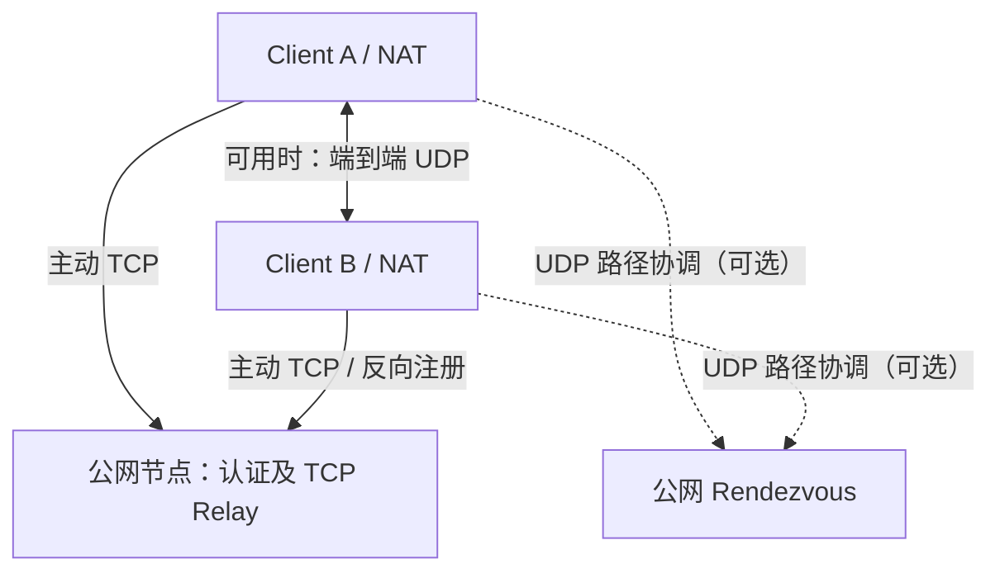

# Transport Core 收口：RSS 与 RPC 共用传输内核

日期：2026-11-27。基线：[f59541a9](https://github.com/RockyLOMO/rxlib/commit/f59541a9708712804a7a12f1c67045bbf31f57e8)（北京时间 17:26:58）。
关联：[RSS 收口计划](rss-upstream-profile-consolidation-plan.md)、[RSS 实施 Review](rxlib_transport_review_20261127.md)、[RPC 参考](reference/net/rpc.md)、[打洞参考](reference/net/punch.md)。

## 1. 决策与范围

- 以 RSS 已实现的通用传输能力为唯一核心，逐步替换 RPC 自有的 Hybrid 数据传输及重复的 UDP 可靠性、重发、分片、去重、压缩和加密。不是长期保留两套算法并让 RPC 选择，也不是让 RPC 依赖 RSS。
- RPC 默认使用 daily 可靠传输策略，RSS 仍保留 plain/daily/weak/game 的既有语义。RPC 方法、事件、Fury 序列化、调用生命周期和业务接口独立保留，先不重写。
- Transport Core 直接提供原始字节流及数据报 client/server 能力，不依赖对象序列化、RPC、SOCKS5、SS、DNS、代理端口策略。RPC 是通用传输的一个应用，而非通用传输的必经层。
- 旧 UdpClient 等重复传输实现的最终目标是退役删除，而不是加永久兼容层。删除前迁移所有实际调用者，区分纯 UDP 数据报、可靠字节流、可靠消息语义。保留必要的原生 Netty TCP/UDP I/O。
- UDP 打洞及双方均在 NAT 后方时的公网 TCP Relay 归入通用路径建立/承载能力，本轮只记录思路，不新增、重写或部署打洞和公网中继功能。
- 安全、正确性、稳定性硬约束；真实流量和 CPU 优先，内存适当放宽但必须有界。严格 Java 8，JDK 21 回归，RSS Server 1 vCPU / 768 MiB 整机基线。减少抽象数量，不重写成熟算法。

## 2. 当前源码现状与复用方向

| 能力 | 现有 RPC/通用旧实现 | RSS 来源或收口方向 |
|---|---|---|
| 可靠混合传输 | HybridClient/Server/DefaultHybridSession | AdaptiveTcpStream、AdaptiveTcpHandler 的通用字节流内核 |
| UDP 可靠性 | UdpClient 整消息 ACK/超时重发，Hybrid 再 TCP fallback | AdaptiveUdpFec 与可靠 TCP 修复，只保留一层恢复机制 |
| UDP 复制 | 通用可选冗余 | AdaptiveUdpReplication，共用算法，RPC daily 不默认启用复制 |
| MTU 与分段 | 固定 UDP fragment payload，逻辑消息阈值 | RssUdpMtuBudget、协商 CHUNK、最终出口 guard |
| 压缩 | 通用旧 pipeline | 现有 zlib 实际压缩与按收益 LZ4 |
| 安全 | 旧 Cipher、Hybrid token | AES-GCM / HMAC、独立协议域/方向/会话密钥、认证后重放窗口 |
| 分片重组 | UdpClient.ReceiveAssembly | RssDatagramFragmenter 的有界认证重组核心 |
| 去重 | HybridSequenceWindow 的 TTL Set | 有界序号窗口，按实际乱序和恢复语义选容量 |
| 路径 | Hybrid 直连/打洞 | 通用路径策略；打洞及公网 relay 暂不开发 |
| 对象/业务 | Fury、MethodMessage、EventMessage | RPC 层保持 |

静态依据：

- [RemotingHybridOptions.java](https://github.com/RockyLOMO/rxlib/blob/f59541a9708712804a7a12f1c67045bbf31f57e8/rxlib/src/main/java/org/rx/net/rpc/RemotingHybridOptions.java#L8-L24)：目前 CONTROL/METHOD/RESPONSE 强制 TCP，EVENT 才允许 Hybrid 选 UDP。不是普通 RPC 请求默认 UDP。
- [DefaultHybridSession.java](https://github.com/RockyLOMO/rxlib/blob/f59541a9708712804a7a12f1c67045bbf31f57e8/rxlib/src/main/java/org/rx/net/transport/hybrid/DefaultHybridSession.java#L133-L248)：旧 Hybrid 会对对象做 UDP 长度估算、独立 UDP 发送、ACK 失败后以同序号发送 TCP。
- [UdpClient.java](https://github.com/RockyLOMO/rxlib/blob/f59541a9708712804a7a12f1c67045bbf31f57e8/rxlib/src/main/java/org/rx/net/transport/UdpClient.java#L539-L641)、[UdpClient.java](https://github.com/RockyLOMO/rxlib/blob/f59541a9708712804a7a12f1c67045bbf31f57e8/rxlib/src/main/java/org/rx/net/transport/UdpClient.java#L700-L755)：ACK 仅按消息 ID 匹配，重组/解码早于 Hybrid token 校验，超时重发整个逻辑消息。
- [AdaptiveTcpStream.java](https://github.com/RockyLOMO/rxlib/blob/f59541a9708712804a7a12f1c67045bbf31f57e8/rxlib/src/main/java/org/rx/net/rss/tcp/AdaptiveTcpStream.java#L85-L88)：RSS 已支持按协商 UDP frame limit 计算分段；[RssDatagramFragmenter.java](https://github.com/RockyLOMO/rxlib/blob/f59541a9708712804a7a12f1c67045bbf31f57e8/rxlib/src/main/java/org/rx/net/rss/udp/RssDatagramFragmenter.java#L287-L321) 已计费 backing buffer。
- [RemotingCodecFactory.java](https://github.com/RockyLOMO/rxlib/blob/f59541a9708712804a7a12f1c67045bbf31f57e8/rxlib/src/main/java/org/rx/net/rpc/RemotingCodecFactory.java)：现有 RPC codec 工厂依赖 UdpClientCodec 和 HybridTcpChannelCodec；收口后由 RPC 自己的应用编码器连接字节传输接口，而非保留旧 UdpClient 作为必需底座。

## 3. 目标结构及原始数据接口

```text
RSS (SOCKS/SS/DNS/端口/上游)      RPC (Fury/方法/事件)
                \                  /
                 通用 Transport Core
                  /              \
           ReliableStream       Datagram
        TCP + UDP daily      原生/增强 UDP
                   \             /
               通用 codec / FEC / MTU / 路径
                      TCP / UDP I/O
```

拟在 org.rx.net.transport 下组织，不要求本次机械迁移所有包名。建议最低限度公共抽象：TransportClient、TransportServer、TransportSession；会话提供明确的可靠有序字节流与独立数据报能力（也可分接口）。ByteBuf 为优先数据类型，明确所有权、异步写完成、读背压、消息边界及关闭语义。不要将两种交付语义混成一个 send(Object)；不强制单一类同时承担所有 socket 职责。

- RAW/无应用序列化：直接收发 ByteBuf 或 bytes。字节流保序、允许任意拆读/合读；应用如需记录边界，自行选择轻量长度帧。数据报保留 datagram 边界，不默认承诺可靠/有序。
- RPC：Fury 将 MethodMessage/EventMessage 等编码为带长度边界的字节流；Core 仅认识字节，不做对象解析、反射、RPC 请求号、事件或序列化。接收方先完整验证并还原传输数据，再由 RPC 解码。
- 禁用序列化应理解为直接使用 Core 的 RAW 接口，而非让 Remoting 的 Java 对象方法在无 codec 时照常工作。不要为了实现普通原始 TCP/UDP 而构造 RPC facade 或 Hybrid 对象。
- Core 内部仍需要必要的分段、协议头、序号、认证、控制帧；关闭应用序列化不等于关闭协议帧或安全编码。
- RSS plain 的原生 UDP、SS 标准 AEAD 和第三方 SOCKS5 必须保留，不把私有可靠流或数据报帧发给不支持该协议的目标。

## 4. RPC daily 的唯一数据传输路径

默认将普通 RPC 方法、响应、事件编码为可靠有序字节流，复用 RSS daily 的 adaptive TCP + UDP 快路径与 TCP 修复，建立认证的可靠 TCP 主通道；UDP 不可用时立即可走 TCP，不等待打洞或阻塞业务。UDP 真实可用后按自适应策略发送，控制面/明确要求可靠主通道的内容仍可保留路径约束。这里的 daily 指公共可靠流策略，不是把所有 RPC 消息都发送为无序普通 UDP；RPC 需要独立数据报语义时才显式选公共 Datagram API，先不改变现有事件交付语义。方法与响应可靠性不得降低。

- 实际压缩、认证加密、FEC、MTU 及重组与 RSS 共享算法；按收益/安全约束启用实际压缩，低频小 RPC 不强行重复压缩；TCP encoded stream 不再被 FEC 层压缩。
- AES-GCM 独立密钥域、方向、nonce 与会话上下文，禁止共用相同 key+nonce；RPC 安全不能依靠端口推断。原有 TCP 安全、认证与访问控制不降低；新旧 wire 必须明确迁移。无需要时不增加额外 UDP 资源或探测。
- 删除 RPC 的 Hybrid 整消息 UDP 重发/TCP fallback，旧 UdpClient ACK 机制不再叠加到新的 adaptive reliable stream；同一业务字节只由 Core 负责可靠恢复。传输 ACK 与业务方法执行成功是不同层次。
- RPC 保留调用 ID、响应关联、超时、取消、线程调度、事件订阅/重订阅与池化/长连接契约。按方法幂等性及跨连接请求 ID 决定重试；非幂等操作执行成功但响应丢失时，不允许无条件重放。保留有界服务端去重/结果缓存或明确未知执行结果，不宣称跨断线 exactly-once。
- 端口跳跃、额外出口格式等不属于 RPC daily 的强制配置；默认不增加相关开销。普通公网服务采用直连路径，禁用打洞。纯 TCP 配置仍可完全不创建 UDP Socket。

## 5. 旧类清理：迁移完成后删除，不永久双栈

候选：HybridClient/Server、DefaultHybridSession、HybridRoutePolicy/State、HybridSequenceWindow、Hybrid*Data/Probe/Hello、HybridTcpChannelCodec、UdpClient/Config/Codec/SendResult 及只服务旧协议的 ACK/重组/重发类。上述是待分析清单，不是已经证明可删除的类；保留仍有语义的通用 API、连接管理和 RPC 适配，并收口命名。

初步依赖证据（代码搜索不是完整调用图）：

- [NameserverImpl.java](https://github.com/RockyLOMO/rxlib/blob/f59541a9708712804a7a12f1c67045bbf31f57e8/rxlib/src/main/java/org/rx/net/nameserver/NameserverImpl.java#L122-L162)：Nameserver replica sync 直接使用 UdpClient、FuryUdpClientCodec、UdpClientConfig，固定单 bind；必须迁移其复制、广播、响应及版本兼容，不能因删除 RPC 旧传输破坏 nameserver。
- [UdpHolePunchServer.java](https://github.com/RockyLOMO/rxlib/blob/f59541a9708712804a7a12f1c67045bbf31f57e8/rxlib/src/main/java/org/rx/net/udp/UdpHolePunchServer.java#L24-L34)、[UdpHolePunchClient.java](https://github.com/RockyLOMO/rxlib/blob/f59541a9708712804a7a12f1c67045bbf31f57e8/rxlib/src/main/java/org/rx/net/udp/UdpHolePunchClient.java)、UdpHolePunchSession：打洞旧代码依赖 UdpClient。打洞不在本轮开发范围。先隔离旧路径且不默认启用；若要彻底删除 UdpClient，需明确退役旧打洞 API，或等未来基于 Core 的打洞迁移后删除最后依赖。不能暗中破坏已有公开打洞功能，也不为保持死代码重建旧可靠协议。
- [KcpClient.java](https://github.com/RockyLOMO/rxlib/blob/f59541a9708712804a7a12f1c67045bbf31f57e8/rxlib/src/main/java/org/rx/net/transport/KcpClient.java) 仍引用共享 codec/消息类型，并拥有自己的可靠传输状态机，不能把外部旧单协议依赖的移除等同于内部 KcpClient 已无调用。纳入重复能力/调用者审查；仅在确证迁移或独立退役决定后删除，不新增/复活已剔除依赖。
- [UdpClientUpstream.java](https://github.com/RockyLOMO/rxlib/blob/f59541a9708712804a7a12f1c67045bbf31f57e8/rxlib/src/main/java/org/rx/net/socks/upstream/UdpClientUpstream.java)、RssClientConf.udpClient 等名字包含 UdpClient，但固定外部 UDP endpoint/承载与 org.rx.net.transport.UdpClient 对象消息实现不是同一事物。不能按字符串全局删除。
- 现有 DefaultTcpClient/TcpServer、TcpChannelCodec、SocketConfig、Netty I/O 和通用 UDP pipeline 可能有非 RPC 消费者；保留需要的基础 I/O，审计与 Core 重复的实际算法/handler，逐步合并，不凭名称删公共类型。

迁移原则：全仓按 import、构造、配置/反射、测试、部署、公开 API 与下游调用扫描；先实现等价能力，迁移消费者并通过回归，再移除无调用旧实现、旧配置、重复定时器与旧 wire 测试。允许明确的短期迁移窗口，不维护两个长期数据面。外部 API 破坏需要明确版本迁移说明；如果存在尚未迁移的调用者，报告删除阻塞，不能伪称收口完成。

## 6. 未来路径能力：UDP 打洞 + 公网 TCP Relay（仅 ADR，不实施）

### 6.1 定位与当前缺口

NAT 打洞属于 Path Discovery / Path Establishment；公网中继属于 Transport Carrier。两者独立于 daily/weak/game 等可靠性策略，也独立于 RPC。RSS 服务通常具备可达公网端点，所以默认只需要直接路径或已配置的外部承载，不需要打洞，也不启动协调服务资源。

现有 [UdpHolePunchServer.java](https://github.com/RockyLOMO/rxlib/blob/f59541a9708712804a7a12f1c67045bbf31f57e8/rxlib/src/main/java/org/rx/net/udp/UdpHolePunchServer.java#L41-L69) 仅登记观测地址并匹配房间；没有承载双方业务 TCP 的中继逻辑。[DefaultHybridSession.java](https://github.com/RockyLOMO/rxlib/blob/f59541a9708712804a7a12f1c67045bbf31f57e8/rxlib/src/main/java/org/rx/net/transport/hybrid/DefaultHybridSession.java#L88-L90) 的连接可用性依赖原 TCP，[DefaultHybridSession.java](https://github.com/RockyLOMO/rxlib/blob/f59541a9708712804a7a12f1c67045bbf31f57e8/rxlib/src/main/java/org/rx/net/transport/hybrid/DefaultHybridSession.java#L362-L407) 在配置 rendezvousEndpoint 后才尝试打洞；默认 rendezvousEndpoint 为空。双方都在 NAT 后且无法建立初始 TCP 时，旧 Hybrid 无法凭空提供 TCP 兜底。

### 6.2 公网节点与双向反向连接

如果 A、B 都位于内网，可使用一个双方可达的公网节点，逻辑上提供两个独立服务：UDP Rendezvous 协调、可靠 TCP Relay。二者可以部署在同一进程/机器，但职责与资源预算独立。



B 发起并保持到公网节点的反向连接，A 也发起公网 TCP 连接；公网节点在授权的逻辑 A-B 会话内转发双向字节流。该模式本质上是反向隧道/中继，不要求 B 拥有公网监听端口。公网节点已有可靠路径时即可传输；直接 UDP 可用则用快路径，打洞失败/UDP 故障时可靠 TCP 仍可通过 A→Relay→B 及相反方向交付；Relay 不可达时明确失败。直接公网 TCP 可用的普通拓扑不要求中继。UDP 成功也不代表可以关闭所有可靠控制/回退连接。

公网节点仅转发授权会话，不能任意访问 B 的内网服务；目标绑定、双端身份、ACL、端到端认证加密、重放保护、背压、资源/速率限制、关闭/撤销、断线行为及故障隔离是未来设计的硬约束。中继不是业务解码器，也不重复执行 FEC 或压缩；实际 UDP 与 TCP 中继的时序/顺序恢复使用同一 Core 会话语义。无兼容可靠通道时不宣称 TCP fallback 可用。

仓库已有 [RrpClient.java](https://github.com/RockyLOMO/rxlib/blob/f59541a9708712804a7a12f1c67045bbf31f57e8/rxlib/src/main/java/org/rx/net/socks/RrpClient.java)、[RrpServer.java](https://github.com/RockyLOMO/rxlib/blob/f59541a9708712804a7a12f1c67045bbf31f57e8/rxlib/src/main/java/org/rx/net/socks/RrpServer.java)，带反向转发、channel 生命周期与有界待写队列等机制。未来应优先评估其作为可靠承载的复用范围，不默认已有完整双 NAT Hybrid 集成，不在本轮另造 RRP 或新增公网 Relay。仅在明确启动该项目后再 review 授权、协议和实际互操作。

### 6.3 未来待验证事项

公网协调端的当前房间 TTL 和单房间 peer 限额不是公网服务完整安全边界；需认证与全局/单源限额，拒绝未授权登记和地址替换。NAT 行为差异、双端网络阻断、真实可达性、回退时的在途数据、反向连接重建和两端重连语义，都需要独立设计和真实环境验证。本文不提供部署方案，不启动协调服务、不新增打洞代码、不引入默认保活或额外公开监听。

## 7. 实施进度与验收记录（2026-11-27，不包含打洞/公网 Relay 开发）

P0 — 先保障稳定性：
- [x] 先处理上一轮 RSS Review 的发布阻塞问题（`P1-01`..`P1-04`、`P2-01`），并修复高丢包实机暴露的 `nftables 1.0.6` 优先级、`AdaptiveTcpHandler` 半关闭 RST 截断与 NAT 下 `claimUdpRelay` 锁死缺陷。
- [x] 明确旧 RPC ACK/身份/资源预算风险与跨连接非幂等重试语义；纯 TCP 配置（`enableAdaptiveUdp = false`）不创建任何 UDP socket（`TransportServer.udpPort() == 0`）。
- [x] 收集全仓旧传输调用图：确认 `NameserverImpl` 迁移至 `DatagramTransport` + `TransportServer`、`KcpClient` 零生产调用可删除、`UdpHolePunch*` 为 `UdpClient` 唯一剩余调用者（打洞不纳入本轮开发，保持隔离）。

P1 — 最小可验证的公共内核：
- [x] 建立 `org.rx.net.transport.core`（`TransportConfig`/`TransportProtocol`/`TransportSession`/`DefaultTransportSession`/`TransportClient`/`TransportServer`/`DatagramTransportConfig`/`DatagramTransport`），直接复用 `AdaptiveTcpHandler`/`AdaptiveUdpPort`/`RssDatagramHandler`/`RssUdpMtuBudget`，零 `rpc`/`socks`/`dns`/`util.rss`/`fury` import。
- [x] 提供 RAW `ByteBuf` 可靠流及独立数据报能力，并通过 `TransportCoreTest`（6/6，纯 TCP 零 UDP socket、daily 自适应 UDP、`FRAME_READY` 屏障、背压/半关闭、认证失败拒绝、认证分片 + FEC、`PARANOID` `LEAK: 0`）。
- [x] RPC 迁移至 Transport Core（`RemotingCodec`/`RpcTransportClientPool`/`RpcTransportClientPoolImpl`/`NonTransportClientPool`/`Remoting`/`RpcClientConfig`/`RpcServerConfig`），`Remoting.register(...)` 返回 `TransportServer`，单层可靠恢复，无第二套 ACK/重发/重复压缩。
- [x] 迁移 `NameserverImpl`（注册服 `TransportServer` + 副本同步单 bind `DatagramTransport`）、`RssClient`、`RssRpcApp`、`WowEndpointRegistry`、`WowEndpointPublisher`。

P2 — 清理与验证：
- [x] 删除 38 个已替代且零调用的旧文件（`org.rx.net.transport.hybrid.*` 主/测全部 29 个文件、RPC 旧 Hybrid/TCP pool 与测试 9 个文件、无生产调用的 `KcpClient`/`KcpClientConfig`/`RxKcp`/`KcpClientTest`），并更新 `docs/reference/net/{rpc,transport,nameserver}.md`。**删除阻塞说明**：`org.rx.net.transport.UdpClient` 当前仅剩 `org.rx.net.udp.UdpHolePunchServer` / `UdpHolePunchClient` 调用，因本轮不实施打洞退役或重写，`UdpClient` 保持隔离保留，待后续打洞独立迁移或退役后再删除。
- [x] 完成 JDK 21 (`21.0.12.1`) 与 JDK 8 (`1.8.0_504`) `PARANOID` 回归，以及 Debian 12 1 vCPU / 960 MiB 高丢包 VPS (`182.255.85.247`) `plain` / `daily` / `weak` 双轮实测（详见 [RSS 实施 Review §6](rxlib_transport_review_20261127.md#6-2026-11-27-整改落地与高丢包-vps-实测记录)）。
- [ ] 按 `master → merge 到 rss-21` 的既有项目流程提交与发布（待用户确认后执行）。

**最终目标：RSS 与 RPC 共用一个不依赖序列化的通用 Transport Core；RPC 仅保留应用协议，旧重复 Hybrid/KCP 传输已退役删除，`UdpClient` 已收口至 `UdpHolePunch*` 唯一遗留边界。NAT 打洞及公网 TCP Relay 为独立未来能力，本轮未实施。**
